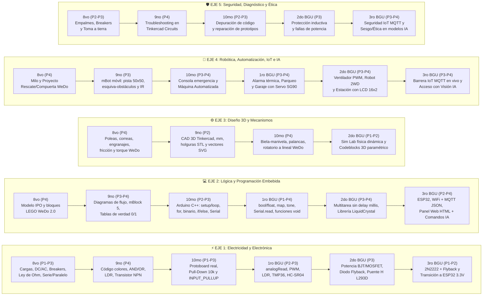

# 🗺️ MAPA DE RUTA CURRICULAR (8VO EGB $\rightarrow$ 3RO BGU)

**Materia:** Robótica y Tecnología  
**Cargo:** Mediador  
**Propósito:** Visualizar cómo cada bloque de aprendizaje se conecta de forma continua desde **8vo EGB** hasta **3ro BGU**, evitando vacíos técnicos y mostrando a los estudiantes **qué aprenden hoy y en qué lo aplicarán el próximo año**.

---

## 🎯 Visión General por Año

| Curso | Título General del Año | Propósito General del Año |
| :--- | :--- | :--- |
| **8vo EGB** | Principios de Electricidad y Control | **Comprobar** principios fundamentales de electricidad, seguridad eléctrica, circuitos serie/paralelo y mecanismos iniciales para controlar la energía de forma segura. |
| **9no EGB** | Diseño Digital y Robótica Móvil | **Diseñar** modelos digitales 3D, rutinas de navegación móvil y circuitos lógicos analógicos para desarrollar prototipos funcionales seguros. |
| **10mo EGB** | Sistemas Programables Iniciales | **Implementar** circuitos en protoboard, programación inicial en Arduino C++ y mecanismos articulados para automatizar respuestas digitales. |
| **1ro BGU** | Sensores y Control Automático | **Construir** sistemas de control automático integrando entradas digitales, señales analógicas (PWM), sensores ambientales y servomotores para responder a estímulos del entorno. |
| **2do BGU** | Mecatrónica Aplicada | **Modelar** sistemas electromecánicos y paramétricos mediante simulación física, programación por bloques, control de potencia e interfaces LCD para validar prototipos interactivos. |
| **3ro BGU** | Sistemas Inteligentes Conectados | **Diseñar** sistemas inteligentes conectados basados en ESP32, telemetría IoT (MQTT) y visión artificial para monitorear y controlar soluciones tecnológicas con criterio ético. |

---

## 🧱 Malla Curricular por Columnas (1 Columna por Curso, Parciales hacia Abajo)

| Parcial | 8VO EGB *Principios de Electricidad y Control* | 9NO EGB *Diseño Digital y Robótica Móvil* | 10MO EGB *Sistemas Programables Iniciales* | 1RO BGU *Sensores y Control Automático* | 2DO BGU *Mecatrónica Aplicada* | 3RO BGU *Sistemas Inteligentes Conectados* |
| :---: | :--- | :--- | :--- | :--- | :--- | :--- |
| **P1** | **8VO-P1:** Fundamentos de Energía y Circuitos | **9NO-P1:** Procesos de Fabricación | **10MO-P1:** Circuitos Base y Montaje en Protoboard | **1RO-P1:** Lógica Condicional y Entradas Digitales | **2DO-P1:** Simulación Física y Dinámica 3D | **3RO-P1:** Conmutación y Control de Potencia |
| **P2** | **8VO-P2:** Conductores, Empalmes y Seguridad Eléctrica | **9NO-P2:** Modelado Digital 3D y Prototipado | **10MO-P2:** Conexiones Seguras y Primer Código | **1RO-P2:** Señales Analógicas y Regulación PWM | **2DO-P2:** Diseño Paramétrico por Bloques | **3RO-P2:** Microcontroladores y Periféricos Digitales |
| **P3** | **8VO-P3:** Ley de Ohm y Circuitos Serie/Paralelo | **9NO-P3:** Navegación y Robótica Móvil | **10MO-P3:** Control Digital, Bucles y Decisiones | **1RO-P3:** Detección Ambiental y Alertas | **2DO-P3:** Electrónica de Potencia y Motores | **3RO-P3:** Telemetría e Internet de las Cosas (IoT) |
| **P4** | **8VO-P4:** Mecanismos y Control Inicial | **9NO-P4:** Electrónica Analógica y Lógica Digital | **10MO-P4:** Mecanismos Articulados y Automatización | **1RO-P4:** Control Angular y Sistemas Autónomos | **2DO-P4:** Interfaces Visuales y Sistemas Integrados | **3RO-P4:** Visión Artificial y Sistemas Autónomos |

---

## 🔗 Diagrama de Líneas de Progresión (Syllabus Conectado)

Cada línea horizontal muestra un **eje formativo** y cómo cada parcial alimenta al siguiente nivel:

---

## 🧭 Guía de Conexiones: "¿Para qué me sirve lo que aprendo hoy?"

Esta tabla resume los puentes directos entre cursos para compartirlos al inicio de cada año o parcial:

### 1. De **8vo EGB** $\rightarrow$ hacia **9no y 10mo EGB**
| Lo que aprendes en 8vo | En qué te ayuda después |
| :--- | :--- |
| **Conductores, aislantes, empalmes y seguridad (P2)** | En **10mo (P2)** harás uniones eléctricas seguras reales y en **9no–2do BGU** evitarás cortocircuitos al armar prototipos. |
| **Ley de Ohm, Serie/Paralelo y Vista Esquemática (P3)** | En **9no (P4)** calcularás/elegirás resistencias por código de colores y leerás planos esquemáticos; en **10mo (P1)** armarás circuitos reales en protoboard sin quemar LEDs. |
| **Poleas, engranajes y modelo IPO en WeDo 2.0 (P4)** | En **9no (P2–P3)** diseñarás piezas con holguras en 3D y programarás sensores en mBot; en **10mo (P4)** construirás mecanismos más complejos (biela-manivela). |

### 2. De **9no EGB** $\rightarrow$ hacia **10mo EGB y 2do BGU**
| Lo que aprendes en 9no | En qué te ayuda después |
| :--- | :--- |
| **Tinkercad 3D, medidas en mm, holguras y vectores `.SVG` (P2)** | En **2do BGU (P1–P2)** pasarás a simular física real en *Sim Lab* y a programar piezas paramétricas en *Codeblocks*. |
| **mBot, diagramas de flujo, velocidad (0–255) y ultrasonido (P3)** | En **10mo (P2–P3)** transformarás esa lógica de diagramas de flujo en código C++ real; en **1ro BGU (P3–P4)** volverás a usar el sensor ultrasonido en Arduino. |
| **Código de colores, `AND`/`OR`, LDR, Transistor y *Troubleshooting* (P4)** | En **10mo (P2–P3)** entenderás por qué Arduino reemplaza cables complejos por código (puente *Transistor vs. Arduino*) y sabrás diagnosticar fallas antes de pedir ayuda. |

### 3. De **10mo EGB** $\rightarrow$ hacia **1ro y 2do BGU**
| Lo que aprendes en 10mo | En qué te ayuda después |
| :--- | :--- |
| **Protoboard, Pull-Down `10kΩ` e `INPUT_PULLUP` (P1, P3)** | En **1ro BGU (P1–P4)** usarás pulsadores confiables sin lecturas falsas en proyectos con múltiples sensores. |
| **Arduino C++: `for`, binario, `if/else` y Monitor Serial (P2–P3)** | En **1ro BGU** será tu idioma base para leer sensores analógicos (`analogRead`), calibrar umbrales en Serial y escribir funciones `void`. |
| **Mecanismos articulados en WeDo 2.0 (P4)** | En **1ro BGU (P4)** y **2do BGU (P1–P3)** entenderás cómo convertir el giro de un servomotor o motor DC en movimiento útil (barreras, bandas, carros). |

### 4. De **1ro BGU** $\rightarrow$ hacia **2do y 3ro BGU**
| Lo que aprendes en 1ro BGU | En qué te ayuda después |
| :--- | :--- |
| **`analogRead`, `map()`, PWM (`analogWrite`) y sensores (P2–P3)** | En **2do BGU (P3–P4)** regularás la velocidad de motores DC con PWM y mostrarás lecturas de sensores en pantalla LCD. |
| **Servomotor SG90, `Serial.read()` y funciones `void` (P4)** | En **3ro BGU (P2–P4)** controlarás servomotores en ESP32 mediante comandos por Internet (MQTT) y comandos enviados desde una IA vía MQTT. |

### 5. De **2do BGU** $\rightarrow$ hacia **3ro BGU**
| Lo que aprendes en 2do BGU | En qué te ayuda después |
| :--- | :--- |
| **Sim Lab y Codeblocks 3D paramétrico (P1–P2)** | Consolida el pensamiento matemático/espacial (coordenadas, variables, bucles) aplicado a ingeniería y diseño. |
| **`millis()`, Transistores BJT/MOSFET, Diodo Flyback y Puente H (P3)** | En **3ro BGU (P1)** arrancas aplicando potencia segura con transistor + diodo Flyback antes de dar el salto al ESP32 sin bloqueos de tiempo. |
| **Pantalla LCD 16x2 (`<LiquidCrystal.h>`) (P4)** | En **3ro BGU (P3–P4)** la LCD se convierte en la interfaz de estado de tu **Barrera de Peaje IoT** y de tu **Acceso Inteligente con Visión IA**. |

### 6. Cierre en **3ro BGU** (Perfil de Egreso)
- **P1–P2:** Integración de electrónica de potencia (`2N2222` + Flyback) y migración a microcontroladores modernos de **$3.3\text{V}$ (ESP32)** en Wokwi.
- **P3:** Conectividad **IoT bidireccional real** (`WiFi` + `MQTT` + Panel Web externo generado con IA) y **ciberseguridad básica** (tópicos/credenciales).
- **P4:** Entrenamiento de modelos de **Visión por Computadora (*Teachable Machine*)**, análisis de **sesgo/ética de datos** y defensa técnica estilo universitario del proyecto final (**IA $\rightarrow$ ESP32 $\rightarrow$ Actuador + LCD**).
